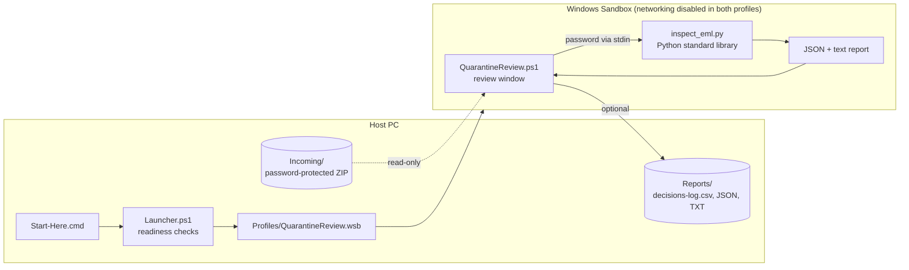
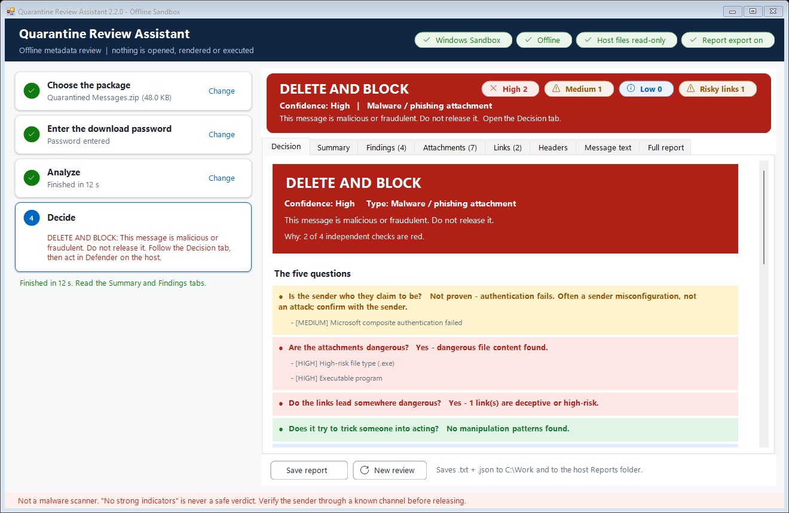
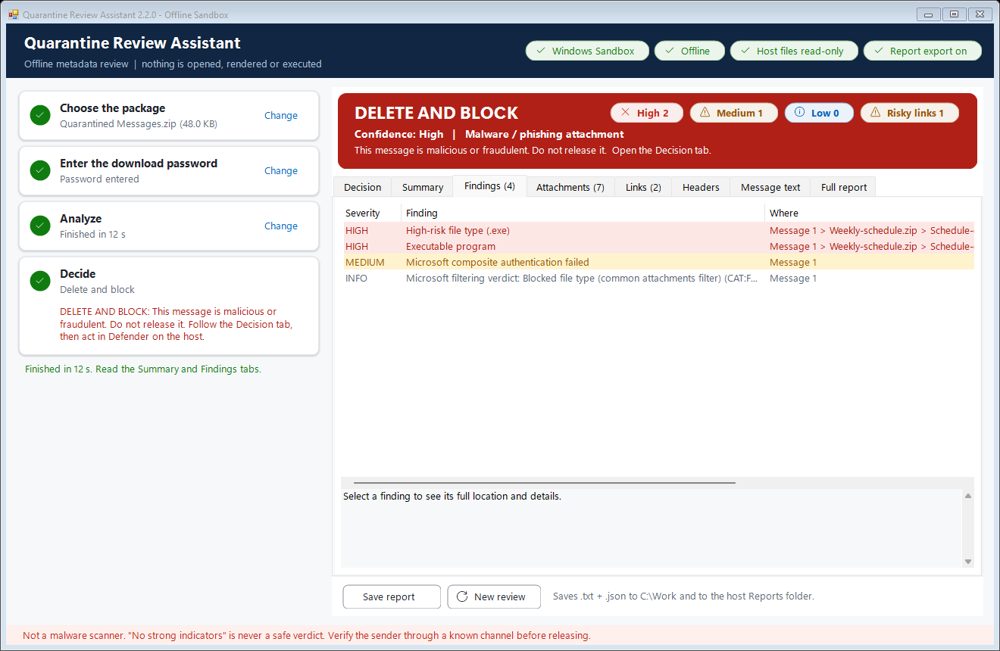
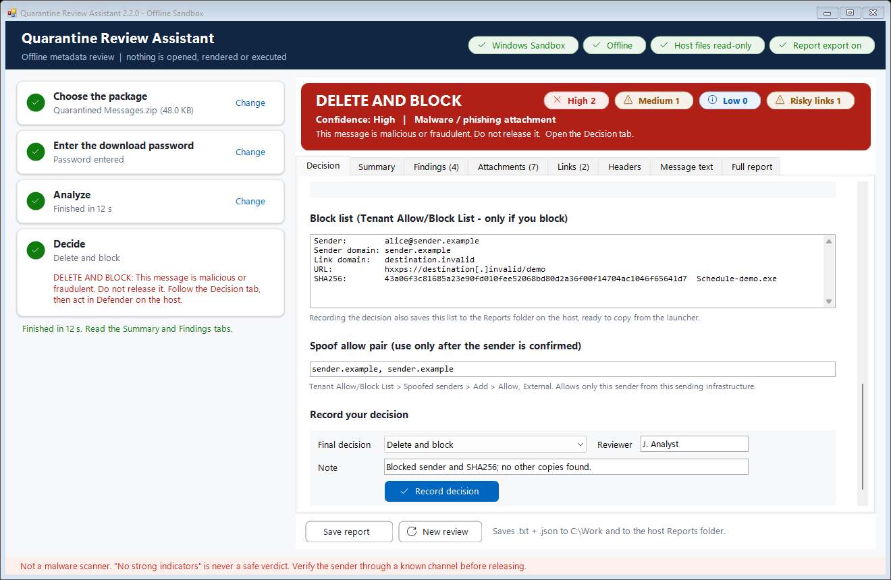

# Quarantine Review Assistant v2.3.0

[](LICENSE)
[](https://github.com/MahmoudGooda/quarantine-review-assistant/releases)
[](https://github.com/MahmoudGooda/quarantine-review-assistant/actions/workflows/ci.yml)


[](https://github.com/MahmoudGooda/quarantine-review-assistant/commits/main)

**Offline, sandboxed review of suspicious quarantined emails (attachments, links and payment fraud) for Microsoft 365 tenants without Defender for Office 365 Safe Attachments.**

https://github.com/user-attachments/assets/250907c1-6d98-4e65-a4bd-1fb413a2e85a

## Why this exists

Tenants that only have Exchange Online Protection (EOP) can download a quarantined message, but they get no detonation and
no Safe Attachments. Admins end up with a password-protected ZIP and no safe place to look inside it. Unknown archives should not be opened on any production machine, and certainly not on one used for administration.

This tool gives them that safe place: a disposable Windows Sandbox with no network, where the message, its attachments and
anything nested inside them are inventoried, hashed and checked, and where nothing is ever executed or rendered.

## When you don't need this

If you have **Defender for Office 365 Plan 1 or 2**, use Safe Attachments, Safe Links and Threat Explorer first. This tool
can still give you a second, offline opinion, for example on a message you do not want to detonate in the cloud.

## Features

- **Decision tab.** One clear recommendation per message, with a confidence level and a one-line reason:
  **DELETE AND BLOCK**, **KEEP QUARANTINED, VERIFY FIRST**, **RELEASE AFTER QUICK CHECKS**, **BULK / MARKETING**, or
  **ANALYSIS INCOMPLETE**.
  - If any content could not be inspected, keep the message quarantined. For ZIPs containing several messages, download and review each message separately.
  - **Five questions** in traffic-light colours: is the sender who they claim to be, are the attachments dangerous, do the
    links lead somewhere dangerous, does it try to trick someone into acting, and what did Microsoft decide?
  - It says plainly whether the tool **agrees** with Microsoft, **disagrees** (a possible false positive) or **found more**.
  - Yes/No checks that only a person can answer, with step-by-step actions in Defender.
- **Guided step rail.** The launcher shows five steps (Prepare this PC, Check it in Defender, Download the message, Analyze in the
  Sandbox, Act in Defender and clean up), each with a status. The review window is a four-step accordion (Choose the package, Enter the
  download password, Analyze, Decide) that opens the step you are on and folds finished steps to a one-line summary.
- **Loading states.** A spinner while the launcher checks the PC, a progress bar for the one-time Python download, and, during the
  analysis, a stage tracker (Reading file, Opening package, Analysing, Building report) with an elapsed time and a **Cancel** button.
- **Nested inspection.** ZIP, then email, then attached ZIP, then files, with hashes and findings at every level.
  Defender ZipCrypto and AES-256 packages are opened in memory.
- **Block list.** Sender, domain, URLs and file hashes for the Tenant Allow/Block List. Shared services such as
  `google.com` or `sharepoint.com` are never proposed for blocking.
- **Audit log.** The CSV records the reviewer, final decision, tool recommendation, Microsoft's verdict and input SHA-256. The companion decision JSON also preserves the reviewer's answers. Enable host report export to keep these files after the Sandbox closes.
- **MITRE ATT&CK tags** on findings (T1566.001/.002/.004, T1598.003, T1657, T1027.006 and others).
- **Accessible and high-DPI.** Keyboard shortcuts (`Ctrl+1` ... `Ctrl+8`, `Ctrl+S`), named controls for screen readers, WCAG AA
  contrast (4.5:1), support for Windows high contrast and reduced motion, and layouts that hold at 100 % to 175 % scaling.

### What it checks

- Nested attachments within the inspection limits, including password-protected archives, risky and disguised file types, HTML/SVG smuggling, PDF and Office active content.
- Messages with no attachment: business email compromise and payment-change requests (IBANs checksum-validated), callback scams, credential and document-share lures, look-alike characters and domains.
- Links: deceptive link text, trusted-site redirects, shorteners, IP/punycode hosts, links that carry the recipient's address.
- Sender and authentication: SPF, DKIM, DMARC (RFC 9989) alignment, compauth reasons, Reply-To and display-name tricks, Microsoft's verdict decoded.

## How it works



The full diagram and a description of each step are in [docs/architecture.md](docs/architecture.md).

## Requirements and quick start

**Requirements:** Windows 10 (1903 or later) or Windows 11, **Pro, Enterprise or Education** (Home has no Windows Sandbox),
CPU virtualization turned on, 4 GB RAM, and access to the Microsoft Defender quarantine page. The only download is the
official Python embeddable package from python.org, once, checked against a pinned SHA256. The optional release-request intake
(below) is the only other network use.

1. Download `QuarantineReviewAssistant-<version>.zip` from the [Releases](https://github.com/MahmoudGooda/quarantine-review-assistant/releases) page
   and check its `.sha256`. Extract the `SecurityReview` folder to a **local, non-synced** drive, for example `D:\SecurityReview`.
2. Double-click **`Start-Here.cmd`**. Step 1, **Prepare this PC**, checks the PC and offers buttons to install Windows Sandbox and to
   download the analysis runtime.
3. Steps 2 and 3 of the launcher cover Defender: open the quarantined message and choose **Download message** with a password. Save
   the ZIP into `Incoming` without opening it, then click **Launch Sandbox review** (step 4, **Analyze in the Sandbox**).
4. In the Sandbox window, choose the package, type the password and press **Enter**. Read the **Decision** tab, then in step 5,
   **Act in Defender and clean up**, act in Defender, close the Sandbox and click **Delete Incoming...**.

| Decision | Evidence | Reviewer action |
|---|---|---|
|  |  |  |

## Release-request intake (optional)

Instead of downloading each message by hand in the Defender portal, the launcher can list the quarantined messages that have a
**pending release request** and save the ones you choose into `Incoming`. Click **Fetch release requests** in step 3 of the
launcher. Manual download from the portal still works and stays the default.

- **You choose, per message.** The list shows only Received, Sender, Recipient, Subject, Quarantine type and Expires, and every
  checkbox starts unticked. Nothing is downloaded automatically and there is no select-all by default.
- **Each ticked message is saved as one password-protected ZIP** in `Incoming`. The whole message goes into one ZIP and its
  attachments stay inside the encrypted ZIP. The launcher checks the ZIP signature and that every entry is encrypted before it writes
  the file, and it never writes an `.eml` or any other file type.
- **Use the same download password in the Sandbox.** You type it once per batch in the dialog (it is not stored or shown again), then
  type it again in the Sandbox review window.
- **Window and limits.** The default window is 16 days (maximum 30). The list shows up to 1000 rows, and says so when it hits that
  limit.

**What it connects to.** The dialog connects **this PC** to Exchange Online but opens no message content. It reads the list and
exports the encrypted ZIPs. Release, deny and delete stay in Defender: the intake uses no cmdlet that changes anything.

**Sign-in.** It is the standard interactive Microsoft sign-in (a Windows account sign-in window, with MFA). There are no stored
credentials, no app registration and no secrets. The tool disconnects when the dialog closes. The Windows account itself stays signed in to Windows, so a second sign-in
in the same Windows session is usually faster.

**The module.** The intake needs the `ExchangeOnlineManagement` PowerShell module. If it is missing, the dialog shows an install
button. Nothing is installed unless you click it. It opens a visible Windows PowerShell 5.1 window that runs:

```powershell
Install-Module ExchangeOnlineManagement -Scope CurrentUser
```

You answer the prompts in that window. It installs for your account only and needs no admin rights.

### Permissions

Per [Microsoft Learn](https://learn.microsoft.com/defender-office-365/quarantine-admin-manage-messages-files), previewing and
downloading quarantined messages for all users needs **Global Reader**, **Security Reader** or **Security Operator**. No release
rights are needed. Verify this in your tenant, because roles and quarantine policies differ.

Manual check before you rely on it:

- [ ] Confirm with a least-privileged reviewer account (for example Security Reader) that listing and export work.

The one-page description for an approver, with the full list of network calls, is in [docs/for-security-teams.md](docs/for-security-teams.md).

## Security design

- For an approver who has never seen this tool: [docs/for-security-teams.md](docs/for-security-teams.md) (what runs where, the complete list of network calls, permissions, retention and how to verify a release).
- Both Sandbox profiles disable **networking**. The default profile also disables clipboard and printer redirection, microphone and camera input, and vGPU. **Compatibility mode** leaves those settings and Protected Client at their Windows Sandbox defaults.
- The tool folder is mapped **read-only**. Only the `Reports` folder can be written to, and only if you allow it.
- **Nothing is executed, rendered or extracted to disk.** HTML is never rendered, attachments are never opened, and archives are
  read in memory.
- **Passwords go through stdin**, never on a command line.
- **ZIP-bomb limits** on size, depth and compression ratio, and a **10-minute timeout** on the analysis.
- **Nothing is uploaded anywhere.** The report tells you which hashes to look up on the host.
- Everything is plain-text PowerShell plus one Python file that uses only the standard library, so it can be read and audited.

**Honest limits.** This is **not an antivirus**. It reads metadata and structure; it cannot see zero-day exploits, text inside
images or QR codes, or links that turn malicious later. **"No strong indicators" is not a safe verdict**, and the tool never says
a message is safe: it tells you what to verify before you release.

## Command-line usage

The review window runs the analyzer for you. To run it by hand inside the Sandbox:

```powershell
& C:\Review\Tools\Python\python.exe -I -B -X utf8 C:\Review\app\inspect_eml.py `
    --input "C:\Review\Incoming\Quarantined Messages.zip" --password-stdin --json-out C:\Work\report.json
```

| Option | Meaning |
|---|---|
| `--input`, `-i` | The quarantine `.zip` or a raw `.eml` (required) |
| `--password-stdin` | Read the download password from the first line of stdin |
| `--secrets-stdin` | Read one JSON line `{"zip_password": "...", "attachment_passwords": ["..."]}` |
| `--json-out`, `--text-out` | Write the JSON report, the text report (default: stdout) |
| `--progress-file`, `--config` | Progress messages for the GUI; `organization.json` with your domains and executives |

Exit codes: `0` complete, `3` finished but incomplete (for example a wrong password), `2` the input could not be processed.
The same Python file also runs on Linux and macOS for testing. See [CONTRIBUTING.md](CONTRIBUTING.md).

## Troubleshooting

- **Sandbox will not start:** untick *Protected Client*, then try *Compatibility mode* (weaker isolation).
- **Review window did not appear:** in the Sandbox, run `C:\Review\Start-Review.cmd`.
- **"Wrong password":** use the password typed in Defender's *Download message* dialog. Check Caps Lock, or download the message again.
- **PowerShell scripts blocked by policy:** ask IT security to allow the tool folder. Do not weaken policy globally.
- **The window is too big or text is cut off on a high-DPI screen:** please open an issue with the Windows scaling value and a screenshot
  (blur anything real).

## Roadmap

### Toward a triage kit

The review tool covers one step. The plan is a small kit for the whole life of a suspicious message, for tenants without Defender for Office 365:

| Version | Component | Status |
|---|---|---|
| v2.3 | **Release-request intake.** List pending release requests using read-only Exchange Online PowerShell and export password-protected messages to `Incoming`. | In progress |
| v2.4 | **Response pack.** Save the Defender steps checklist with the decision, export the block list as a `New-TenantAllowBlockListItems` script or CSV, find other copies with message trace or Content search, and provide a user-notification template. | Planned |
| v2.5 | **Batch mode.** Analyze a folder of user-reported messages in one summary, remember the reviewer's name and improve `.msg` handling. | Planned |
| v2.6 | **Decisions dashboard.** Summarize monthly review volume, malicious messages, false positives and common message types from `decisions-log.csv`. | Planned |
| v2.7 | **Quarantine posture check.** Review quarantine policies for malware and high-confidence phishing, release-request alerts and reviewer roles. For general mail-protection settings, see [ORCA](https://github.com/cammurray/orca). | Planned |
| v2.8 | **Enterprise readiness.** Allow-list guidance in readiness checks, run the analyzer in any isolated VM with an HTML report, Intune deployment notes, code signing. | Planned |
| v3.0 | **Playbook and training lab.** Publish a one-page release-request procedure and synthetic practice cases. | Planned |

## Contributing

Pull requests are welcome. Please read [CONTRIBUTING.md](CONTRIBUTING.md) first, and never attach real quarantined mail to an
issue or a pull request. To report a vulnerability, see [SECURITY.md](SECURITY.md). Changes are listed in [CHANGELOG.md](CHANGELOG.md).

Provided as-is. Issues and pull requests are welcome; there is no guaranteed support.

## License

[MIT](LICENSE). Third-party notes are in [THIRD_PARTY_NOTICES.md](THIRD_PARTY_NOTICES.md).

## Credits

Built by Mahmoud.

*Disclaimer: this project is not affiliated with or endorsed by Microsoft. Microsoft, Microsoft 365, Defender and Windows are
trademarks of Microsoft Corporation.*
