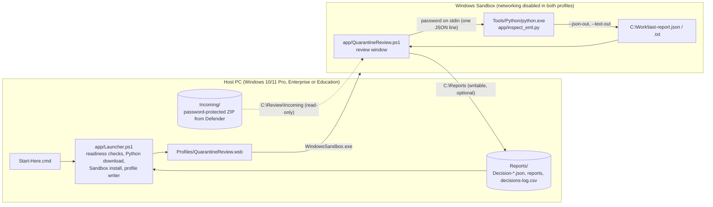

# Architecture

Quarantine Review Assistant has four moving parts. Only the first one runs on the host PC; the other three run inside a
disposable Windows Sandbox that has no network.

## 1. Host launcher: `app/Launcher.ps1`

Started by `Start-Here.cmd`. It reads the incoming file to compute its SHA-256. Message parsing and archive extraction run inside the Sandbox. The launcher:

- checks the Windows edition, CPU virtualization, memory and disk, the Windows Sandbox feature, a pending restart, the portable
  Python runtime, and whether the tool folder is on a cloud-synced or network drive;
- offers **Install** (through `app/Enable-Sandbox.ps1`, elevated by a UAC prompt) and **Download** (the official Python
  embeddable package from python.org, SHA256-verified, extracted into `Tools\Python`);
- writes `Profiles\QuarantineReview.wsb`, disables networking, maps the tool folder read-only to `C:\Review`, optionally maps `Reports` to `C:\Reports`, and starts the review window at logon;
- disables vGPU, clipboard and printer redirection, microphone and camera input in the default profile. Compatibility mode leaves these settings and Protected Client at the Windows Sandbox defaults;
- enables **Copy block list** for a completed decision matching the SHA-256 of the single incoming package.

### Optional: release-request intake (v2.3)

The launcher can open a dialog (`app/ReleaseRequests.ps1`) that connects the **host PC** to Exchange Online. This is the only
host-side connection besides the one-time Python download, and it sits at the trust boundary: only metadata (the message list) and
the **bytes of password-protected ZIPs** cross it. Nothing is decoded, opened, rendered or extracted on the host. The ZIP bytes are
checked structurally (signature, central directory, every entry encrypted) and written to `Incoming` as `.zip` files only. Parsing
and extraction still happen only inside the Sandbox.

- One long-lived **STA background runspace** per dialog holds the Exchange Online session, so the window stays responsive during
  sign-in. The dialog polls it with a timer.
- The sign-in is the module's default interactive (Windows account) sign-in. Before it starts, the launcher hides its console
  window so the sign-in window opens in front.
- The session is **disconnected when the dialog closes**, including when the launcher itself closes. Disconnecting ends the Exchange
  Online session; the Windows account stays signed in to Windows.
- The intake uses read and export cmdlets only. Release, deny, delete and block list changes stay in Defender.

For the plain-language version, see [for-security-teams.md](for-security-teams.md).

## 2. Review window: `app/QuarantineReview.ps1`

Runs inside the Sandbox. It checks that it really is in a Sandbox, offline and read-only (the status chips), starts the
analyzer as a child process, sends the passwords through its standard input, and shows the JSON result in eight tabs:
**Decision, Summary, Findings, Attachments, Links, Headers, Message text, Full report**. **Record decision** writes
the companion reports and audit row for each target before publishing its completed decision JSON. The save dialog identifies any target that failed.

## 3. Analyzer: `app/inspect_eml.py`

Python standard library only. It reads a Defender quarantine ZIP (ZipCrypto or AES-256) or a raw `.eml`, walks the message and
everything nested in it in memory, and builds a report. Limits on size, depth and compression ratio protect against ZIP bombs.

### JSON report

| Key | Content |
|---|---|
| `tool`, `version`, `generated_utc` | Identification |
| `input` | `name`, `size`, `hashes` (`sha256`, `sha1`, `md5`), `signature` |
| `container` | Package details, encryption, password status and message count. A multi-message package sets `requires_individual_review` and returns a `RERUN` decision with no actionable sender or block list. |
| `messages[]` | One node per email: `headers`, `auth`, `alignment`, `eop`, `eop_category`, `received`, `body_preview`, `attachment_count`, `children[]` |
| `children[]` | Attachment and archive-entry nodes: `name`, `where`, `size`, `signature`, `encryption`, `hashes`, `tags`, `note`, `children[]` |
| `findings[]` | `severity` (`high`, `medium`, `low`, `info`), `code`, `title`, `detail`, `where`, `attack` |
| `urls[]` | `url`, `defanged`, `host`, `flags[]`, `severity`, `sources[]`, `anchor` |
| `assessment` | `level` (`HIGH RISK`, `SUSPICIOUS`, `NO STRONG INDICATORS`, `INCOMPLETE`), `headline`, `advice`, `counts`, `suspicious_links` |
| `decision` | `outcome` (`DELETE`, `VERIFY`, `RELEASE`, `BULK`, `RERUN`), `title`, `confidence`, `message_type`, `why`, `scorecard[]`, `checks[]`, `steps`, `iocs`, `spoof_pair` |
| `errors[]`, `complete`, `unlocked[]` | Inspection problems, completion status, and the location and password source of unlocked archives (`operator` or `message_body`) |

`where` is a path such as `Message 1 > Invoice.zip > Invoice.exe`.

## 4. Outputs

The report and the decision go to `C:\Work` (inside the Sandbox, lost when it closes) and, if you allowed it, to the host
`Reports` folder: `Decision-*.json`, `Decision-*-report.txt`, `Decision-*-report.json` and `decisions-log.csv`, which is the audit
trail. Formula-like CSV fields are escaped for spreadsheets. The decision JSON preserves the original field values.
The launcher treats records without a boolean `record_complete: true` and matching input SHA-256 as history. Reanalyze the package to produce a current record. The host opens historical CSV logs in Notepad.

## UI kit: `app/QraUi.ps1`

Both windows dot-source this file right after `Add-Type -AssemblyName System.Drawing`. It holds everything they share:

- **DPI and layout helpers:** `S`, `SPad`, `SSize`, `SPoint`, `Limit-FormToScreen`, `Set-Access`, `Measure-Wrapped`, `Initialize-QraForm`
  and `Set-QraEmulatedDpi` (screenshots only).
- **Tokens:** the palette `$C` (keyed by role: `Surface`, `Card`, `Text`, `Primary`, `Success`, `Warning`, `Danger`, ...) and the icon glyph table
  `$QraGlyph`. Every text pair is checked in Pester at 4.5:1 or more, and control borders and the focus ring at 3:1 or more.
  With Windows high contrast on (or `QRA_UI_HIGHCONTRAST=1`) the tokens map to `SystemColors` and nothing draws a shadow or gradient.
- **Fonts:** `New-Font` uses Segoe UI Variable (Windows 11) and falls back to Segoe UI; `Get-IconFont` uses Segoe Fluent Icons and falls back
  to Segoe MDL2 Assets. `QRA_UI_WIN10FONTS=1` forces the Windows 10 families.
- **Painted controls** (namespace `QraUi`, C# compiled once per process with `Add-Type`): `RoundPanel`, `Spinner`, `StepBadge`, `Pill`,
  `ModernButton`. They are created through `New-QraCard`, `New-QraSpinner`, `New-QraStepBadge`, `New-QraPill` and `New-QraButton`.
  The painted spinner appears only after 300 ms (the plain fallback spinner shows at once) and stays at least 500 ms, so near-instant work never flashes. With reduced motion it draws a static clock.
- **Fallback:** the factories return plain WinForms controls (today's look) when the compile fails, when `QRA_UI_FALLBACK=1`, or when
  PowerShell is not in Full Language mode (the kit itself never calls `Add-Type` in Constrained Language Mode). WinForms cannot load in Constrained
  Language Mode, so the windows cannot start there at all: allow the tool folder (AppLocker/WDAC) so the scripts run in Full Language.
  `$script:UiNative` says which mode is active and `$script:QraDisplayReason` says why it is basic.
- **Background work:** `Start-QraWork` runs a script block in its own runspace (`Start-Job` takes 1-2 s to start in Windows PowerShell 5.1).
  Progress comes back through the synchronized hashtable `$work.State`; poll it with `Test-QraWork` and finish with `Complete-QraWork`.
  `Stop-QraWork` cancels.

## Display scaling

Both windows declare DPI awareness before any window exists. Controls that exist when the form first lays out are scaled by
`AutoScaleMode = Dpi`. Everything that WinForms does not scale (list-view column widths, tab padding, tree item height) and everything
created later (decision cards, check rows, the record panel) is scaled once, by hand, with the `S()` helper. No control is scaled by both.

The kit follows the same rule. Painted geometry (circle size, glyph size, padding) comes from `ClientSize` and `Font`. Every other constant
(corner radius, shadow size, and the border width and focus-ring width through the `Stroke` and `FocusRingWidth` properties, minimum 1 px)
is passed through `S()` by the factory (`New-QraCard`, `New-QraPill` and `New-QraButton` set `Stroke = S 1`, and the button `FocusRingWidth = S 2`). Kit controls that exist when the form lays out take
plain 96-dpi `Size` and `Location`, exactly like other controls. `Initialize-QraForm` sets `AutoScaleMode = Dpi`.

## Guided steps and screenshots

Both windows describe their progress with a pure function that maps facts to a state per step, so the logic can be tested without a window:
`Get-LauncherStepState` in `Launcher.ps1` (five steps) and `Get-ReviewStepState` in `QuarantineReview.ps1` (four steps). Each step is
`Done`, `Working`, `Current` or `Pending`, with a one-line summary (the password is only ever summarised as `Password entered`). `Update-Stepper`
(launcher) and `Update-ReviewStepper` (review window) apply the state to the rail or accordion, and in the review window
`ConvertTo-AnalysisStage` turns the analyzer's progress text into the stage tracker position. `Get-EmptyPrompt` chooses the prompt shown
before an analysis.

Both scripts accept `-Screenshot <folder>`, with `-ScreenshotDpi <n>` (emulate another display scale), `-ScreenshotMinSize` (render at the
minimum window size) and, for the review window, `-ScreenshotResult <report.json>`. They apply each state from fake data, render the form to
`launcher-<state>.png` or `review-<state>.png` with `DrawToBitmap` (the form is created off screen at opacity 0 because it must be shown to
be drawn) and exit. Nothing is read from `Incoming`, no process is started and no polling or analysis timer runs (a painted spinner is drawn once, without its 300 ms delay or animation). The environment variables `QRA_UI_FALLBACK=1`,
`QRA_UI_WIN10FONTS=1` and `QRA_UI_HIGHCONTRAST=1` apply to screenshots too, which is how the plain-control, Windows 10 font and high-contrast
looks are checked.

## Security software

Checked on 2026-11-25 on a Windows 11 Pro PC with Microsoft Defender Antivirus on: both windows were launched (`Launcher.ps1`, and
`QuarantineReview.ps1 -AllowHost`) and left open for about 20 seconds each.

- `Get-MpComputerStatus`: `AMRunningMode = Normal`, `RealTimeProtectionEnabled = True`.
- `Get-MpThreatDetection` entries created during the launch: none.
- Events in `Microsoft-Windows-Windows Defender/Operational` with IDs 1006-1017 and 1116-1119 during the launch: none.

Result: no alert. The scripts are not signed, so a different antivirus product, or a stricter policy (AppLocker, WDAC, Constrained Language
Mode), could still react. In Constrained Language Mode WinForms cannot load, so the windows cannot start; allow the tool folder (AppLocker/WDAC) so
it runs in Full Language. The kit's guard only stops the kit itself from calling `Add-Type` there.
